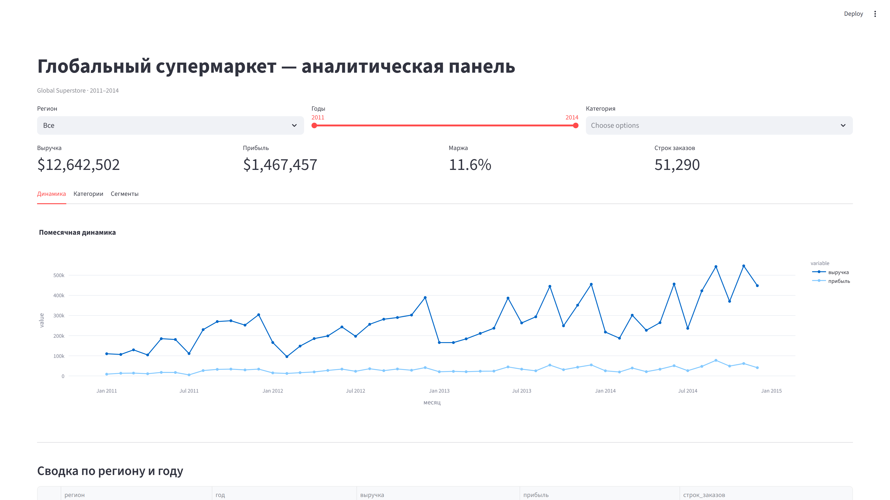
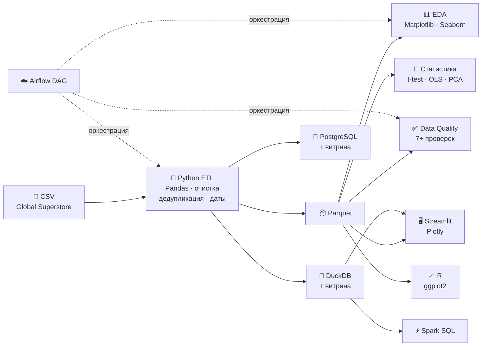
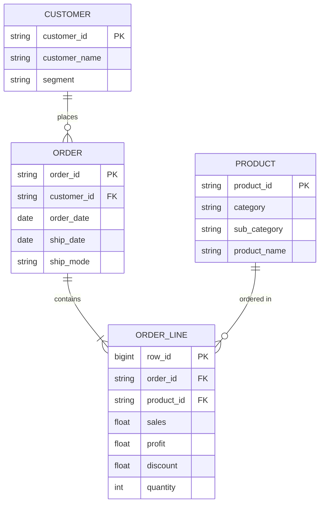

# 📊 Global Superstore — аналитика продаж


> **Полный цикл data-аналитики** на датасете Global Superstore (51 000+ строк, 2011–2014):
> сбор → очистка → хранение → анализ → визуализация → оркестрация.

---

## 📈 Ключевые результаты

| Показатель | Значение |
|:-----------|:---------|
| Выручка | **$12.6 млн** |
| Прибыль | **$1.47 млн** |
| Маржа | **11.6 %** |
| Строк после очистки | **51 289** |
| Регионов | **13** |
| Период | **2011–2014** |

### Прибыль по категориям

| Категория | Прибыль |
|:----------|:--------|
| 🖥 Технологии | $663 779 |
| 📎 Канцтовары | $518 474 |
| 🪑 Мебель | $285 205 |

### Статистика

- **t-критерий Уэлча** — прибыль без скидки vs со скидкой: различие значимо (p ≪ 0.05)
- **Линейная регрессия** — выручка ~ количество + скидка + доставка: **R² ≈ 0.60**
- **PCA** — 2 компоненты объясняют ~100% дисперсии агрегированных KPI сегментов

---

## 🖥 Дашборд (Streamlit)

Интерактивная панель с фильтрами по регионам, годам и категориям:



---

## 📊 Графики

### Выручка по регионам


### Распределение прибыли


### Маржа по категориям (R)


---

## 🏗 Архитектура пайплайна



---

## 🧠 Продемонстрированные навыки

| Навык | Где посмотреть |
|:------|:---------------|
| **ETL / очистка данных** | [`superstore/etl/load_and_clean.py`](superstore/etl/load_and_clean.py) — CSV → Parquet, восстановление дат, дедупликация, strip |
| **Data Quality** | [`superstore/etl/data_quality.py`](superstore/etl/data_quality.py) — 11 автоматических проверок |
| **SQL (DuckDB)** | [`sql/duckdb/`](sql/duckdb/) — аналитические запросы, агрегатные витрины |
| **SQL (PostgreSQL)** | [`sql/postgres/init.sql`](sql/postgres/init.sql) — DDL, индексы, VIEW |
| **Python-анализ** | [`superstore/analysis/eda.py`](superstore/analysis/eda.py) — describe, группировки, визуализации |
| **Статистика / ML** | [`superstore/analysis/stats_models.py`](superstore/analysis/stats_models.py) — t-test, OLS, PCA, scikit-learn |
| **Визуализация** | Matplotlib, Seaborn, Plotly (дашборд) |
| **Дашборд** | [`dashboard/app.py`](dashboard/app.py) — Streamlit + Plotly |
| **R** | [`r/analysis.R`](r/analysis.R) — dplyr, ggplot2 |
| **Spark** | [`spark/run_pyspark.py`](spark/run_pyspark.py) — PySpark SQL |
| **Airflow** | [`dags/superstore_etl.py`](dags/superstore_etl.py) — DAG с 4 тасками |
| **Docker** | [`docker-compose.yml`](docker-compose.yml) — PostgreSQL |
| **Тесты** | [`tests/test_etl.py`](tests/test_etl.py) — pytest, unit + интеграционные |

---

## 📁 Структура проекта

```
testsomeshi/
├── superstore/          Python: ETL, анализ, загрузчики, labels
│   ├── etl/             load_and_clean, data_quality
│   ├── analysis/        EDA, статистика (scipy, sklearn)
│   ├── loaders/         PostgreSQL loader
│   └── embeddings/      ChromaDB (опционально)
├── dashboard/           Streamlit + Plotly
├── sql/                 DuckDB, PostgreSQL, ClickHouse, Greenplum
├── spark/               PySpark SQL
├── dags/                Airflow DAG
├── r/                   R-скрипт (dplyr, ggplot2)
├── docs/                отчёты, ERD, PNG-графики
├── scripts/             PowerShell-скрипты запуска
├── tests/               pytest (unit + интеграция)
├── data/                raw CSV + processed Parquet (не в git)
└── notebooks/           Jupyter
```

---

## Модель данных



Подробнее: [docs/model.md](docs/model.md)

---

## 🚀 Быстрый старт

<details>
<summary><b>Развернуть инструкцию по запуску</b></summary>

### Установка

```powershell
git clone https://github.com/lllexalllepexa/testsomeshi.git
cd testsomeshi
python -m venv .venv
.\.venv\Scripts\Activate.ps1
pip install -r requirements.txt
```

### Основное (без Docker)

| Действие | Команда |
|:---------|:--------|
| ETL | `python -m superstore.etl.load_and_clean` |
| Качество данных | `python -m superstore.etl.data_quality_runner` |
| EDA, графики | `python -m superstore.analysis.eda` |
| Статистика | `python -m superstore.analysis.stats_models` |
| Тесты | `pytest tests/ -q` |
| Дашборд | `.\scripts\run_streamlit.ps1` |
| SQL (DuckDB) | `.\scripts\sql_duckdb_demo.ps1` |
| R | `Rscript r/analysis.R` |
| Пайплайн целиком | `.\scripts\run_pipeline.ps1` |

### С Docker

| Действие | Команда |
|:---------|:--------|
| PostgreSQL | `.\scripts\run_postgres.ps1` |
| Airflow | `.\scripts\run_airflow_docker.ps1` |

### Дополнительно

| Действие | Команда |
|:---------|:--------|
| Spark | `pip install pyspark` → `python spark/run_pyspark.py` |
| ChromaDB | `pip install chromadb sentence-transformers` → `python -m superstore.embeddings.chroma_products` |
| Jupyter | `jupyter notebook notebooks/01_eda_overview.ipynb` |

</details>

---

## 📖 Документация

| Документ | Описание |
|:---------|:---------|
| [docs/otchet.md](docs/otchet.md) | Полный отчёт с графиками и таблицами |
| [docs/model.md](docs/model.md) | ERD, витрины данных |
| [docs/airflow.md](docs/airflow.md) | Airflow DAG |
| [docs/bi.md](docs/bi.md) | Superset, DataLens, Power BI |
