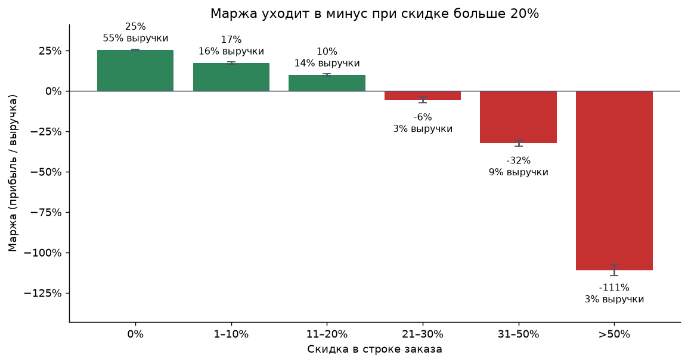
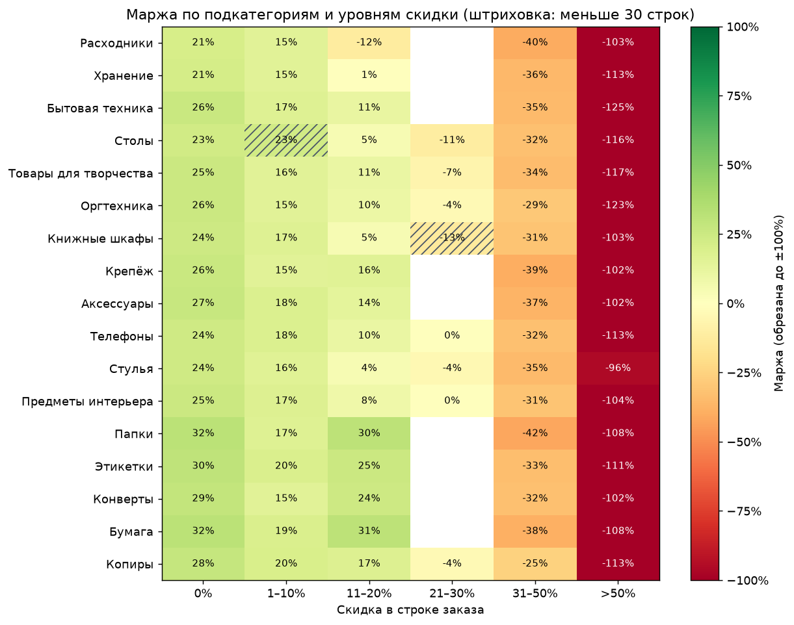
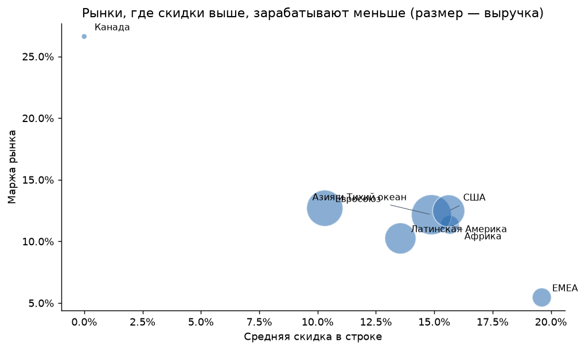
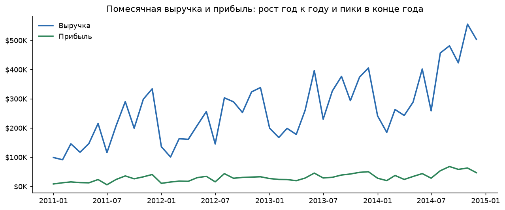
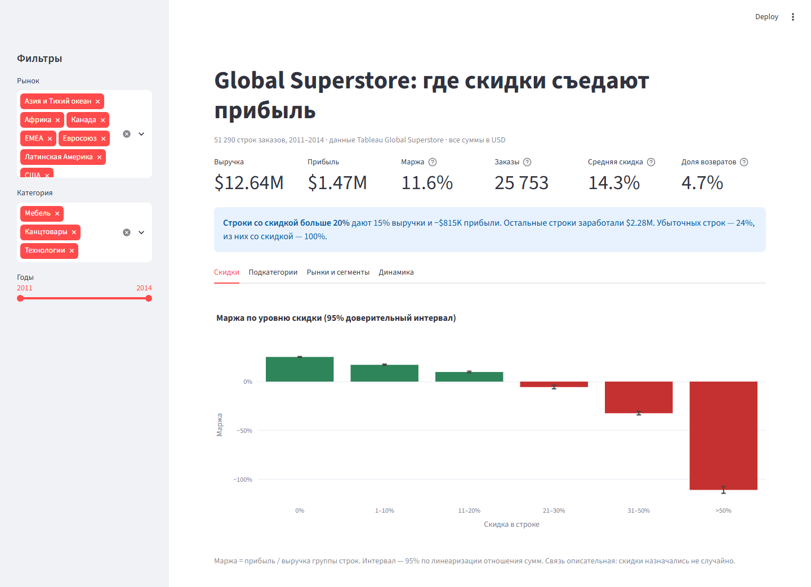
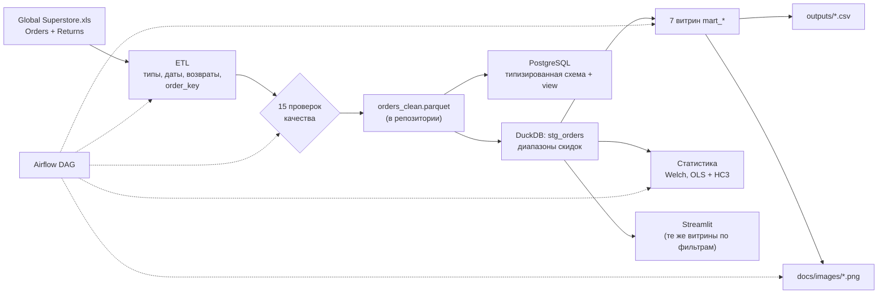

# Global Superstore: где скидки съедают прибыль


> Анализ 51 290 строк заказов (25 753 заказа, 2011–2014) учебной сети Global Superstore: Excel → проверенный Parquet → SQL-витрины в DuckDB → статистика → дашборд на Streamlit, плюс загрузка в PostgreSQL и Airflow DAG. Все цифры ниже получены кодом из этого репозитория и проверяются тестами.

## Бизнес-вопрос

Сеть продала товаров на **$12,64 млн** и заработала **$1,47 млн** — маржа **11,6%**. Где компания теряет деньги и какую роль в этом играют скидки?

## Главное

**1. Скидка больше 20% почти всегда означает убыток.** Без скидки маржа 25%, при скидке 11–20% — 10%, при 21–30% уже −6%, а при скидке больше 50% компания теряет больше, чем выручает (−111%).



| Скидка | Доля выручки | Прибыль | Маржа (95% ДИ) | Убыточных строк |
|---|---:|---:|---:|---:|
| 0% | 55% | $1 770 695 | 25,3% (24,9–25,7%) | 0% |
| 1–10% | 16% | $338 189 | 17,2% (16,5–18,0%) | 19% |
| 11–20% | 14% | $173 255 | 9,9% (9,0–10,7%) | 23% |
| 21–30% | 3% | −$21 156 | −5,5% (−7,3…−3,7%) | 62% |
| 31–50% | 9% | −$380 945 | −32,4% (−34,2…−30,6%) | 87% |
| > 50% | 3% | −$412 582 | −111,0% (−114,5…−107,6%) | 100% |

[`outputs/05_discount_bands.csv`](outputs/05_discount_bands.csv)

**2. Строки со скидкой больше 20% — 15% выручки и −$815 тыс. прибыли.** Остальные строки заработали $2,28 млн, глубокие скидки забрали больше трети. Все 12 544 убыточные строки (24% от всех) — со скидкой; без скидки в данных нет ни одной убыточной продажи.

**3. Эффект не объясняется товарным миксом или рынком.** В регрессии маржи строки с поправкой на подкатегорию и рынок (OLS, n = 51 290, R² = 0,77, робастные ошибки HC3) скидка 21–30% снижает маржу на 28,7 п.п. (95% ДИ 27,4–30,0), а 31–50% — на 59,3 п.п. по сравнению с продажей без скидки. Внутри каждой категории строка со скидкой в среднем приносит меньше: мебель −$137, технологии −$138, канцтовары −$39 на строку ([`stats_discount_ttest.csv`](outputs/stats_discount_ttest.csv)).

**4. Столы — единственная убыточная подкатегория (−$64 тыс.), и дело в скидках.** 44% выручки от столов приходится на скидки больше 20%: эти строки потеряли $133 тыс., остальные заработали $68 тыс. Глубокие скидки бьют и по прибыльным товарам: книжные шкафы потеряли на них $90 тыс., телефоны — $87 тыс.



**5. Рынки с более щедрыми скидками зарабатывают меньше.** У EMEA самая высокая средняя скидка (19,6%) и самая низкая маржа (5,5%). Канада не даёт скидок вообще и держит маржу 26,6%, но это всего 0,5% выручки.



**6. Продажи растут: $2,26 млн в 2011 → $4,30 млн в 2014 (+90%),** с пиками в сентябре, ноябре и декабре ([`02_monthly_sales.csv`](outputs/02_monthly_sales.csv)).



## Что предлагаю бизнесу

1. **Ввести потолок скидки 20%** с согласованием исключений. Строки выше порога дают 15% выручки и −$815 тыс. прибыли.
2. **Начать со столов и рынка EMEA:** там глубокие скидки встречаются чаще всего и дороже всего обходятся.
3. **Проверить потолок экспериментом,** а не сразу на всей сети. Данные показывают, сколько стоят глубокие скидки, но не показывают, сколько покупателей уйдёт без них. Пилот на одном рынке с контрольной группой ответит на этот вопрос до раскатки.

## Ограничения

- **Связь, а не причинность.** Скидки назначались не случайно; модель учитывает подкатегорию и рынок, но не спрос, сезон акций или цели менеджеров.
- **Учебные данные.** Global Superstore — вымышленная сеть из сэмпла Tableau. Прибыль в нём жёстко связана со скидкой (без скидки нет ни одной убыточной строки), поэтому эффект здесь чище, чем был бы в реальной рознице.
- **Маржа строки — отношение.** Таблица выше считает маржу как сумму прибыли / сумму выручки группы; модель описывает среднюю маржу строки. Поэтому числа близки по смыслу, но не совпадают.

## Дашборд



Фильтры по рынку, категории и годам. Каждый график — это одна из SQL-витрин, пересчитанная на отфильтрованных строках, поэтому дашборд и выгрузки в `outputs/` считают метрики одинаково.

```bash
streamlit run dashboard/app.py
```

Данные лежат в репозитории, поэтому дашборд можно опубликовать в Streamlit Community Cloud без дополнительной настройки: New app → этот репозиторий → `dashboard/app.py`.

## Данные

- **Источник:** сэмпл-датасет Tableau «Global Superstore», файл `Global Superstore.xls` (листы Orders, Returns, People). Копия есть на Kaggle: [shekpaul/global-superstore](https://www.kaggle.com/datasets/shekpaul/global-superstore).
- **В репозитории:** очищенный [`data/processed/orders_clean.parquet`](data/processed/orders_clean.parquet) (3 МБ), поэтому всё, кроме ETL, работает сразу после `git clone`.
- **Пересобрать Parquet из исходника:** положить файл в `data/raw/` и запустить `python -m superstore.etl.load_and_clean`. ETL проверен на `Global Superstore.xls` с SHA-256 `7a0498554c2675a2d118986dc7e52ed7208ae85bd6287965b1dd2c72538ea51e`; принимает также xlsx или CSV-выгрузку листа Orders.

Особенности, которые пришлось обработать (подробно — [docs/model.md](docs/model.md)):

- `Order ID` повторяется у разных клиентов и в разных странах, поэтому заказ определяется как Order ID + Customer ID: 25 753 заказа, а не 25 035;
- лист Returns называет рынок `United States`, а Orders — `US`; без поправки теряются 296 из 1 173 возвратов;
- `Shipping Cost` рассчитан от суммы заказа (корреляция с выручкой 0,77), поэтому в модели его нет: он бы «подсказывал» ответ;
- ETL ничего не восстанавливает и не отбрасывает молча: битые даты Excel (`00:00.0`) останавливают загрузку, а 15 проверок качества (ключи, диапазоны, справочники, отгрузка не раньше заказа) должны пройти до записи Parquet.

## Как устроено



| Шаг | Код |
|---|---|
| ETL: Excel/CSV → Parquet | [`superstore/etl/load_and_clean.py`](superstore/etl/load_and_clean.py) |
| Проверки качества | [`superstore/etl/data_quality.py`](superstore/etl/data_quality.py) |
| Staging и витрины (DuckDB SQL: оконные функции, `FILTER`, доверительные интервалы) | [`sql/duckdb/`](sql/duckdb/) |
| Статистика | [`superstore/analysis/stats_models.py`](superstore/analysis/stats_models.py) |
| Графики | [`superstore/analysis/charts.py`](superstore/analysis/charts.py) |
| Пайплайн одной командой | [`superstore/pipeline.py`](superstore/pipeline.py) |
| PostgreSQL: схема и атомарная загрузка | [`sql/postgres/init.sql`](sql/postgres/init.sql), [`superstore/loaders/load_postgres.py`](superstore/loaders/load_postgres.py) |
| Оркестрация | [`dags/superstore_etl.py`](dags/superstore_etl.py), [docs/airflow.md](docs/airflow.md) |
| Дашборд | [`dashboard/app.py`](dashboard/app.py) |

## Методы

| Что | Как |
|---|---|
| Маржа | сумма прибыли / сумма выручки группы строк |
| Доверительный интервал маржи | 95%, линеаризация отношения сумм: `se = sqrt(Σ(profit − m·sales)² / (n(n−1))) / mean(sales)` |
| Разница прибыли со скидкой и без | t-тест Уэлча: разница средних в $ с 95% ДИ и разница медиан, отдельно по каждой категории; p-значение вторично — при 51 тыс. строк значимо почти всё |
| Модель маржи | OLS: `маржа строки ~ диапазон скидки + подкатегория + рынок`. Скидка взята диапазонами, потому что маржа падает нелинейно. Тест Бройша — Пагана отвергает однородность остатков (p < 0,001), поэтому ошибки HC3; [диагностика остатков](docs/images/margin_model_residuals.png) |
| Заказ | Order ID + Customer ID |
| Доля возвратов | доля заказов, отмеченных в листе Returns (4,7%) |

## Быстрый старт

Нужен Python 3.11+.

```bash
git clone https://github.com/lllexalllepexa/testsomeshi.git
cd testsomeshi
python -m venv .venv
source .venv/bin/activate              # Windows PowerShell: .venv\Scripts\Activate.ps1
pip install -r requirements-dev.txt
```

```bash
python -m superstore.pipeline          # проверки → витрины → статистика → графики
streamlit run dashboard/app.py         # http://localhost:8501
python scripts/check.py                # ruff + все тесты
```

PostgreSQL (нужен Docker):

```bash
docker compose up -d postgres
python -m superstore.loaders.load_postgres
```

## Тесты

53 теста ([подробно](tests/README.md)): точные значения всех витрин на 10 строках, посчитанных вручную; каждая проверка качества срабатывает на внесённом дефекте; модель восстанавливает заранее заданные эффекты; полный прогон совпадает с закоммиченными `outputs/`; дашборд и загрузка в настоящий PostgreSQL.

Облачный CI для этого аккаунта GitHub недоступен, поэтому проверки запускаются локально (`python scripts/check.py`) и перед каждым коммитом через pre-commit; workflow в `.github/workflows/ci.yml` запускается вручную.

## Структура

```text
├── data/processed/orders_clean.parquet   # очищенные данные (в репозитории)
├── data/raw/                             # исходный файл (не в git)
├── superstore/                           # ETL, проверки, витрины, статистика, графики, пайплайн
├── sql/duckdb/                           # staging и 7 витрин
├── sql/postgres/init.sql                 # схема PostgreSQL
├── outputs/                              # выгрузки витрин и статистики (сверяются тестами)
├── docs/                                 # графики, модель данных, Airflow, BI
├── dashboard/app.py                      # Streamlit
├── dags/                                 # Airflow
├── tests/                                # фикстуры и тесты
└── scripts/check.py                      # линтер + тесты одной командой
```
