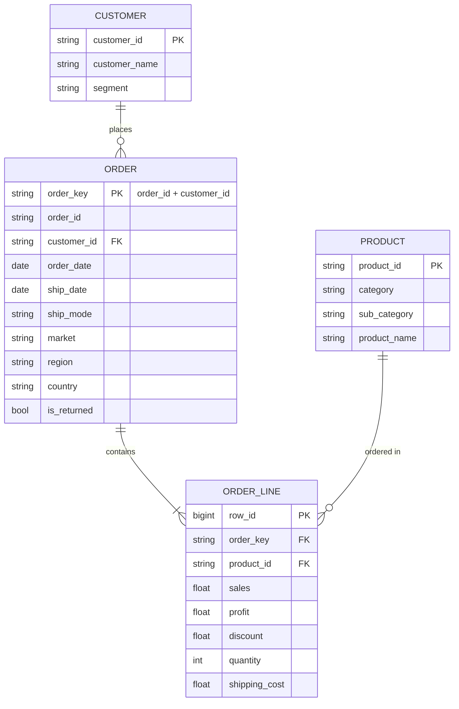

# Модель данных

Исходник — один лист `Orders` (строка = строка заказа) и лист `Returns` (возвращённые заказы). После ETL это одна широкая таблица `orders`; логическая модель:

## Особенности исходных данных

| Что | Как обработано |
|---|---|
| `Order ID` повторяется у разных клиентов и в разных странах (659 номеров) | заказ = `order_key` = Order ID + Customer ID: 25 753 заказа вместо 25 035 «уникальных» номеров |
| Лист Returns называет рынок `United States`, а Orders — `US` | алиас при объединении; без него теряются 296 из 1 173 возвратов |
| Возврат указан на уровне пары (Order ID, Market) | флаг `is_returned` ставится всем строкам этой пары |
| `Postal Code` пуст у 80% строк (вне США) | колонка не загружается |
| `Shipping Cost` рассчитан от суммы заказа (корреляция с выручкой 0,77) | не используется как объясняющая переменная |

## Слои

| Слой | Где | Что |
|---|---|---|
| Parquet | `data/processed/orders_clean.parquet` | очищенные строки + `order_key`, `year`, `delivery_days`, `profit_margin`, `is_returned` |
| Staging | [`sql/duckdb/stg_orders.sql`](../sql/duckdb/stg_orders.sql) | диапазоны скидок, месяц заказа — определены один раз |
| Витрины | [`sql/duckdb/marts/`](../sql/duckdb/marts/) | 7 таблиц `mart_*`, выгрузки в [`outputs/`](../outputs/) |
| PostgreSQL | [`sql/postgres/init.sql`](../sql/postgres/init.sql) | типизированная таблица `orders` с ограничениями, view `mart_region_year`, `mart_discount_bands` |
